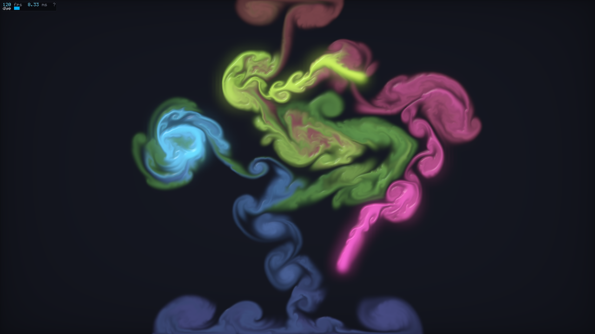

# fluid2d

Jos Stam's Stable Fluids in two dimensions, in real time and entirely on
the GPU: an incompressible flow on a 1280×720 grid, stirred by three
slowly circling jets and by the mouse, carrying coloured dye that is
drawn as a lit, glowing height field. Every step is a handful of WGSL
compute kernels, every frame one render pass; nothing is read back and
nothing is allocated while the window is open.



```sh
cd examples/gpu/fluid2d
../../../target/volec main.vl -o fluid2d
./fluid2d                        # the window: drag to stir
./fluid2d --rows 512 --iters 80  # a coarser grid, a tighter projection
./fluid2d --view velocity --panel expanded
./fluid2d --headless             # no display needed: the numbers
./fluid2d --headless --bench     # the GPU's time for a step
./fluid2d --frames 600 --shot shot.ppm   # 600 frames, then the last one
```

The plain build is the whole build: `std::gpu` and `std::window` name
the frameworks they link, and the example has no C and no `unsafe`.
`-O2` changes nothing visible, since the time goes to the GPU.

## Controls

| input | action |
|---|---|
| left drag | stir, with dye in the brush's colour |
| right drag | push, without dye |
| space | pause / resume |
| `r` | reset the flow and the dye |
| `v`, `1`–`4` | next view; dye, velocity, pressure, curl |
| `c` | the brush's colour: rainbow, then six hues |
| `e` | the jets on / off |
| `b` | the glow on / off |
| `l` | the lighting on / off |
| `?` or Tab | the panel: compact / expanded |
| `h` | hide / show the panel |
| `q` / Esc | quit |

The jets fade out while you stir and come back three seconds after you
stop, so a stroke is never drowned by them.

## The overlay

The panel is drawn by the render shader itself, from a 5×7 bitmap font
([font.vl](font.vl)) scaled by whole pixels (one font pixel a point), so
it stays crisp at any window size and costs no extra pass. By default it
is compact: two short lines in the top-left corner, the frame rate and
frame time, the view, a swatch of the brush's colour and `paused` when
it is. `?` or Tab expands it to the grid's size, the settings with
clickable `[-]` and `[+]` (Jacobi iterations, vorticity, brush size,
dye fade) and the keys; `h` hides it. `--panel compact|expanded|hidden`
picks the first mode. The CPU writes the panel's cells (a character and
a colour each, a fixed `[u32; 312]`) twice a second or when something
changes; clicks on it are hit-tested in [ui.vl](ui.vl) and never reach
the fluid.

## The kernels

The grid is a MAC grid: pressure, divergence, curl and dye at the cell
centres, the x velocity on the vertical faces and the y velocity on the
horizontal ones, with solid walls on all four sides. One step, recorded
into one compute pass ([sim.vl](sim.vl) `Sim::step`, the WGSL in
[shaders.vl](shaders.vl)):

| kernel | what it does |
|---|---|
| `ADVECT_VEL` | semi-Lagrangian advection of each face's velocity (an RK2 backtrace, bilinear samples), plus the jets' and the mouse's forces |
| `CURL` | the vorticity at each cell centre |
| `CONFINE` | vorticity confinement (Fedkiw, Stam and Jensen): a force along N×ω that gives back the small swirls the grid smooths away |
| `DIVERGENCE` | what flows out of each cell through its four faces |
| `JACOBI` | one Jacobi iteration of the pressure equation, ping-ponged 40 times a step and warm-started from the last step's pressure; a wall is no neighbour (the Neumann condition) |
| `PROJECT` | each inner face's velocity minus the pressure difference across it: what is left has no divergence |
| `ADVECT_DYE` | the dye carried by the projected velocity (bilinear), plus the jets' and the brush's dye, faded a little each step |
| `BLOOM`, `BLUR` ×2 | the glow: the dye's bright parts at a quarter of the grid each way, then a 9-tap Gaussian blur across and down |
| `MEAN` | the pressure's mean, in one workgroup, for the pressure view only (a pressure is defined up to a constant, which drifts) |
| `RENDER` | a triangle over the window: the dye sampled bilinearly, a tone curve, lit as a height field, the glow and a vignette; or the velocity (hue from direction), the pressure or the curl; and the panel |

## The headless check

`--headless` runs 400 steps on a 256×256 grid with the jets on for the
first half and off for the second, then reads the buffers back once. It
prints the divergence's rms just before and after the last projection,
and how much dye was kept over the 200 steps it was only carried (dye
only moves then, so a good advection keeps it). `--check` prints the
verdicts instead, and exits 1 if one fails:

```console
$ volec main.vl -o fluid2d
ok: built fluid2d
$ ./fluid2d --headless --check
256 x 256 cells, 400 steps, 40 Jacobi iterations a step
divergence after projection under 5% of before: ok
dye kept within 10% while it is only carried: ok
```

Measured on an Apple M5: 40 iterations leave 2.2% of the divergence,
400 leave 0.4%, and with `--iters 0` (no projection at all) all of it
stays and the check fails; the dye kept is 99%.

## How fast

`--headless --bench` times steps submitted back to back on the window's
16:9 grid, with and without a 2560×1440 picture (the window's size on a
Retina display), on an Apple M5:

| grid | ms a step | ms with the picture |
|---|---|---|
| 910×512 | 1.7 | 2.4 |
| 1280×720 (the default) | 3.2 | 3.8 |

The window runs at the display's rate, 120 fps on a ProMotion display
(`--frames 600` prints the mean frame time: 8.33 ms), with about half
of each frame to spare. The Jacobi iterations are most of the step;
`--iters` and the panel's `[-]`/`[+]` trade the projection's accuracy
for time.

## The parts

| file | what |
|---|---|
| [main.vl](main.vl) | the CLI, the window and its event loop, the frame (parameters, step, picture, one submission), the headless run and the benchmark |
| [sim.vl](sim.vl) | the GPU side: the buffers, pipelines and bind groups (made once), the parameters' uniform, `step`, `draw`, `reset`, the readbacks for the check |
| [shaders.vl](shaders.vl) | the WGSL, a part per kernel, compiled at run time by `std::gpu::wgsl` |
| [ui.vl](ui.vl) | the overlay: its cells, its text, its modes and its hit test |
| [font.vl](font.vl) | the 5×7 font, ASCII 32 to 126 |

New to vole? `volec guide gpu` and `volec guide window` cover the APIs
this example uses.
